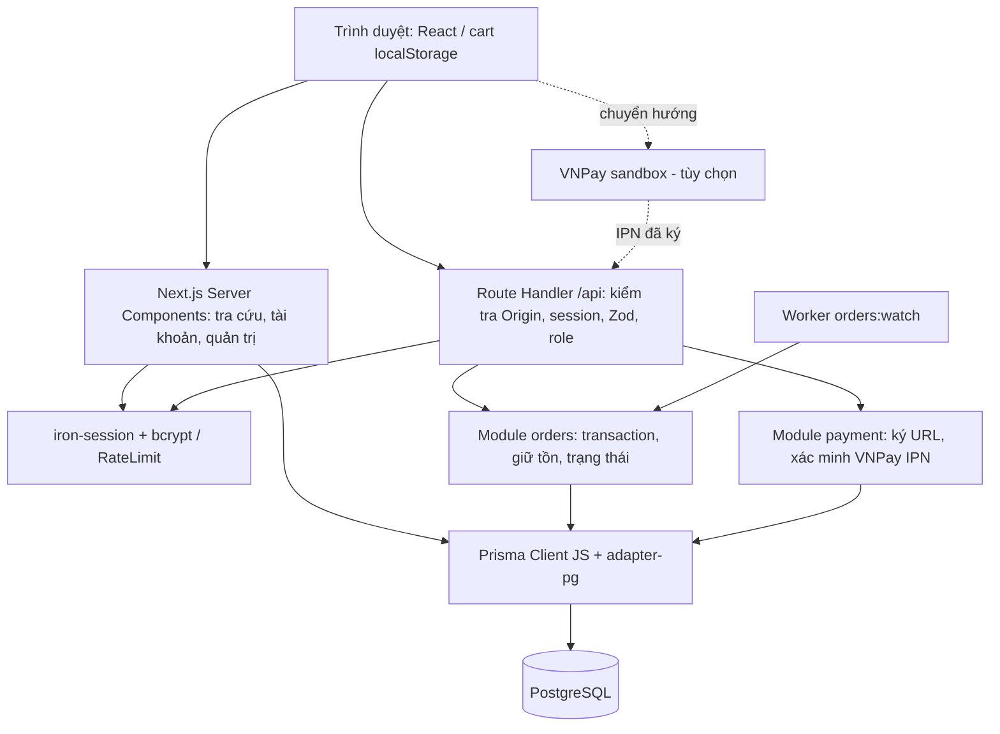
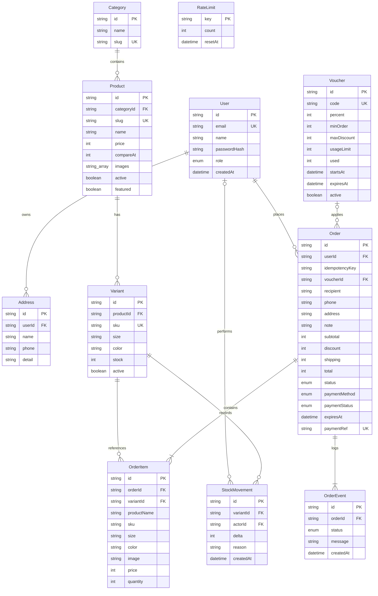
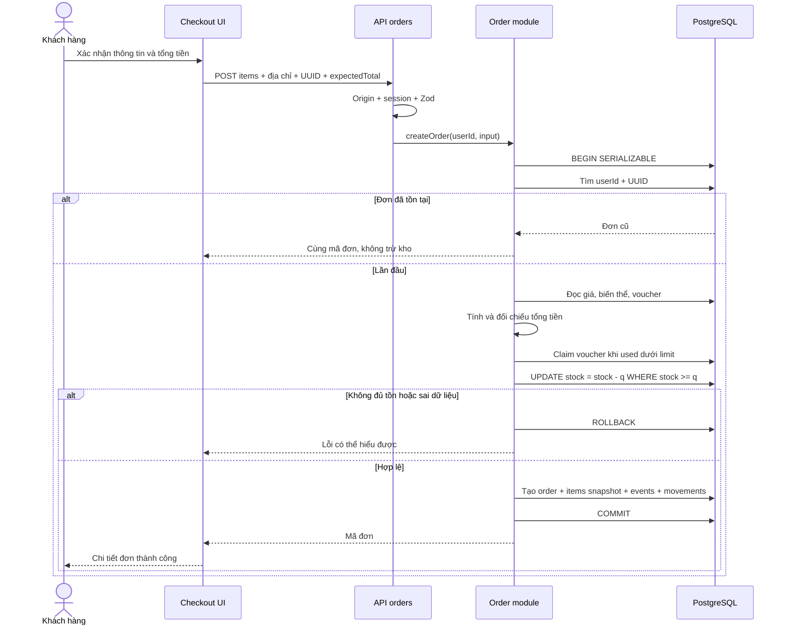
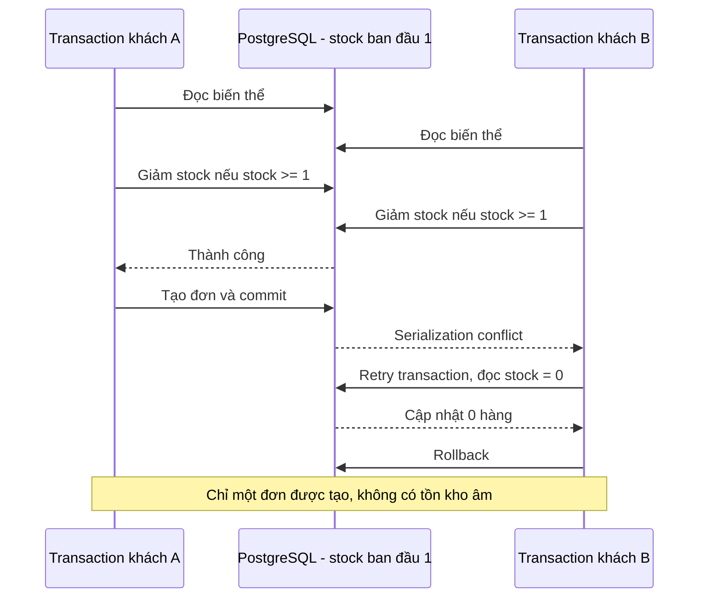
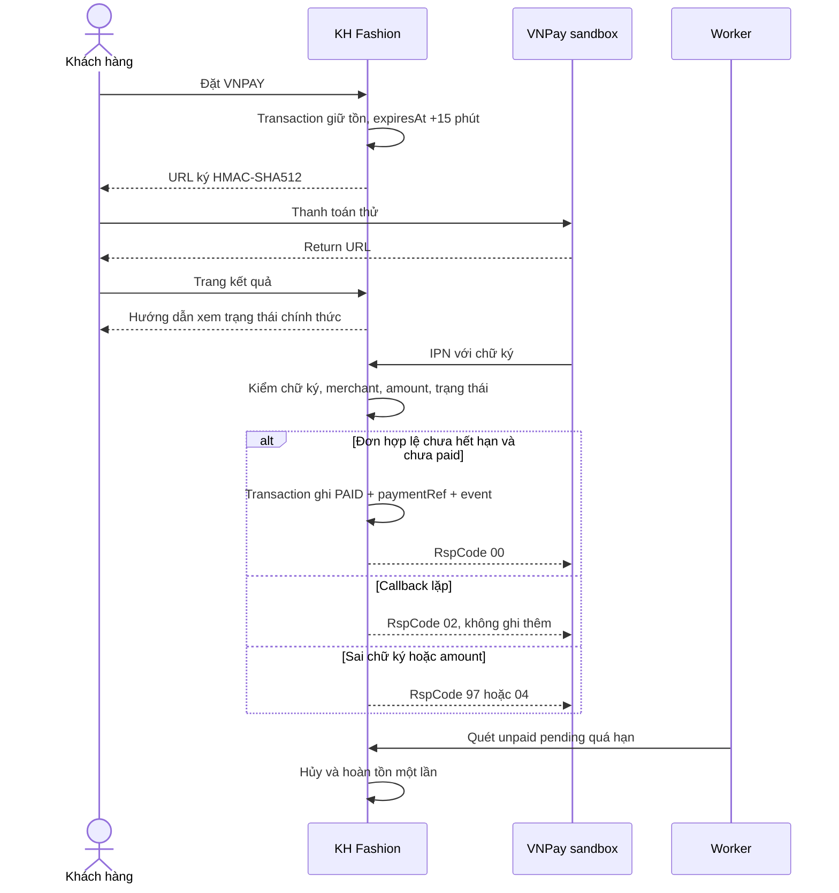
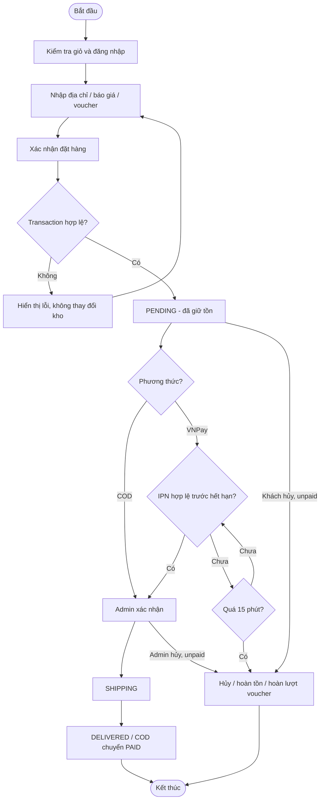
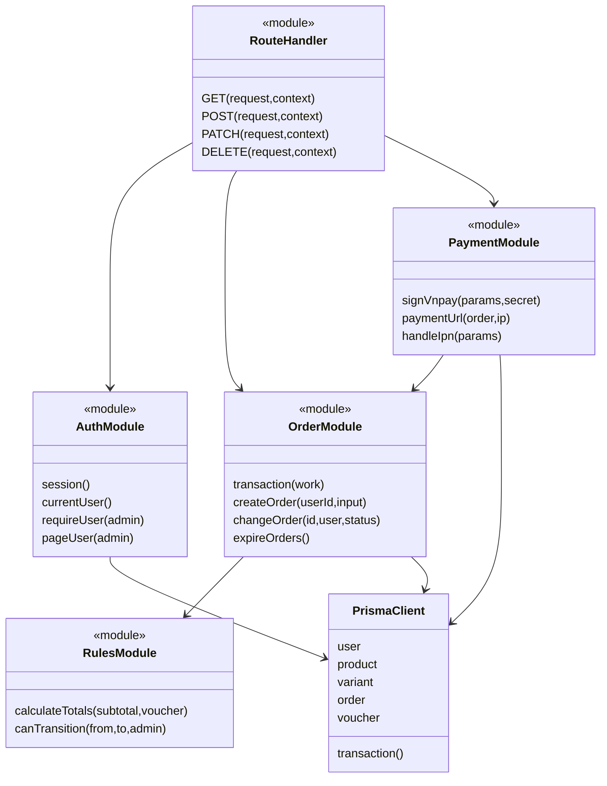

# Thiết kế hệ thống

## Kiến trúc triển khai

Một ứng dụng Next.js xử lý UI và API. Server Components đọc DB, Client Components gọi API cho thay đổi dữ liệu. Role đọc từ DB theo userId trong phiên, không nhận từ client. Các trang admin và API đều kiểm tra quyền. Worker là process riêng, không được giả định sống lại cùng snapshot.

## ERD

Chi tiết đầy đủ tại `prisma/schema.prisma`; ERD rút gọn một số thuộc tính mô tả/timestamps. `OrderItem` lặp thông tin sản phẩm có chủ đích để bảo toàn lịch sử. Unique `(productId,size,color)` và `(userId,idempotencyKey)`. Stock không âm, tổng tiền hợp lệ, giới hạn voucher và giá được bổ sung bằng CHECK trong migration thứ hai. Không cascade xóa lịch sử bán hàng. Địa chỉ là snapshot trên đơn, không liên kết động tới Address.

## Sequence — Checkout và idempotency

## Sequence — Hai khách mua sản phẩm cuối

Thứ tự khách thắng có thể đảo. Transaction retry tối đa 5 lần; unique constraint xử lý hai request cùng UUID. Giữ thứ tự variantId khi cập nhật nhiều dòng để giảm deadlock.

## Sequence — VNPay sandbox

URL return không cập nhật PAID. Thanh toán đến sau khi đơn bị hủy cần đối soát/hoàn tiền ngoài hệ thống; chưa triển khai tự động. Sơ đồ thể hiện thiết kế đã có mã nguồn, chưa chứng minh kết nối merchant thật.

## Activity — Xử lý đơn

## Mô hình lớp và module

Code sử dụng function/module TypeScript, không ép thành mô hình lớp MVC không tồn tại. Stereotype `module` phân biệt với lớp `PrismaClient` thực tế. Tách nghiệp vụ đơn hàng khỏi HTTP giúp kiểm thử transaction mà không cần trình duyệt.
