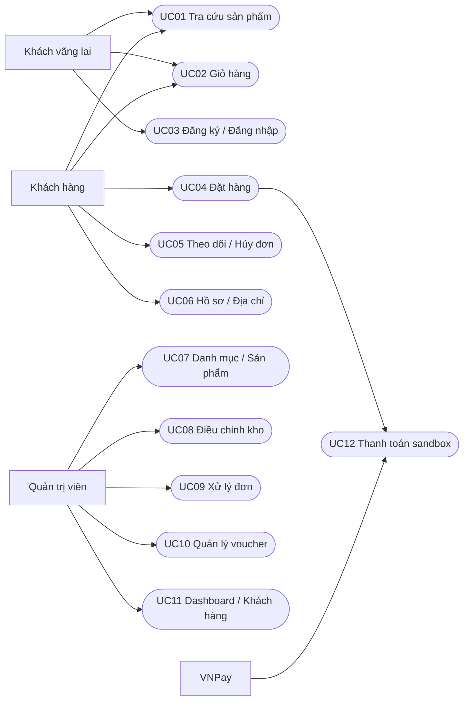

# Use Case

Sơ đồ trên là bản đồ actor/chức năng biểu diễn bằng Mermaid, không giả định flowchart là ký pháp UML Use Case chuẩn.

## UC01 — Tra cứu sản phẩm

**Actor:** mọi khách. **Tiền điều kiện:** DB có sản phẩm đang bán.

1. Khách mở danh mục, nhập từ khóa và bộ lọc.
2. Server chỉ truy vấn sản phẩm active có biến thể active, kết hợp điều kiện size/màu trên cùng biến thể.
3. Server trả tối đa 9 sản phẩm mỗi trang theo sắp xếp đã chọn.
4. Khách mở chi tiết, xem ảnh và tồn lựa chọn.

**Ngoại lệ:** không khớp hiển thị empty state; sản phẩm ẩn hoặc slug không tồn tại trả trang 404. **Hậu điều kiện:** không thay đổi dữ liệu.

## UC02 — Giỏ hàng

**Actor:** mọi khách. **Tiền điều kiện:** biến thể đang bán và còn hàng.

1. Khách chọn màu, size, số lượng rồi thêm giỏ.
2. Client gộp cùng variantId, giới hạn theo tồn đã biết và tối đa 20.
3. Khách sửa số lượng/xóa; localStorage giữ giỏ khi tải lại.
4. Checkout kiểm tra lại toàn bộ dữ liệu tại server.

**Ngoại lệ:** hết hàng vô hiệu nút mua; dữ liệu lưu bị hỏng được bỏ qua; tồn đã thay đổi báo lỗi khi báo giá/đặt hàng. **Hậu điều kiện:** chỉ giỏ trên thiết bị thay đổi, chưa giữ kho.

## UC03 — Xác thực

1. Nhập email/mật khẩu; đăng ký thêm tên, mật khẩu 8–72 ký tự.
2. Server kiểm tra giới hạn 15 phút theo IP và email băm, kiểm tra Zod.
3. Đăng ký băm mật khẩu cost 12, luôn tạo CUSTOMER. Đăng nhập so bcrypt.
4. Cookie mã hóa lưu userId; mỗi request lấy lại role từ DB.

**Ngoại lệ:** trùng email 409; sai thông tin 401; quá giới hạn 429. **Đăng xuất:** hủy cookie. **Hậu điều kiện:** có/không có phiên hợp lệ, không trả passwordHash ra client.

## UC04 — Đặt hàng COD

**Actor:** khách hàng. **Tiền điều kiện:** đăng nhập, giỏ không rỗng.

1. Khách chọn địa chỉ đã lưu hoặc nhập người nhận, điện thoại và địa chỉ.
2. Client gọi báo giá server; khách áp voucher nếu muốn.
3. Khách xác nhận; client giữ một UUID idempotency cho lần checkout và các lần gửi lại.
4. Server mở transaction Serializable, kiểm tra đơn đã có theo userId + UUID.
5. Đọc biến thể đang bán, giá, voucher/thời hạn/lượt; tính tổng.
6. So tổng tiền khách đã nhìn thấy; từ chối nếu thay đổi.
7. Trừ tồn bằng cập nhật có điều kiện, ghi StockMovement; tăng lượt voucher.
8. Tạo Order, OrderItem snapshot và OrderEvent; commit.
9. Trả mã đơn, client xóa giỏ và mở chi tiết.

**Ngoại lệ:** chưa đăng nhập 401; thiếu hàng 409; sai voucher 400; lỗi bất kỳ rollback toàn bộ; xung đột transaction retry; request lặp trả đơn đã có, không giữ thêm kho. **Hậu điều kiện:** một đơn PENDING/UNPAID, số liệu kho và voucher nhất quán.

## UC05 — Theo dõi và hủy đơn

1. Khách mở danh sách đơn của chính mình, xem dòng hàng, địa chỉ, thanh toán và lịch sử.
2. Khách yêu cầu hủy đơn PENDING/UNPAID.
3. Server kiểm tra ownership, trạng thái và payment trong transaction.
4. Hoàn kho, ghi lịch sử, giảm used voucher, chuyển CANCELLED.

**Ngoại lệ:** không thuộc khách trả 404; đơn đã xác nhận hoặc đã trả tiền từ chối; hủy lặp cùng trạng thái không thay đổi thêm. **Hậu điều kiện:** mỗi đơn hoàn tồn tối đa một lần; không thực hiện hoàn tiền.

## UC06 — Hồ sơ và địa chỉ

Khách sửa tên, lưu/sửa/xóa địa chỉ của mình. Email không sửa qua biểu mẫu này. Mỗi tài khoản tối đa 10 địa chỉ, kiểm tra giới hạn trong transaction. Địa chỉ đơn hàng là snapshot, xóa địa chỉ lưu không ảnh hưởng đơn cũ. Địa chỉ của người khác không thể xóa.

## UC07 — Danh mục và sản phẩm

Admin tạo/sửa danh mục; chỉ xóa khi trống. Tạo/sửa sản phẩm, giá, ảnh, mô tả và chất liệu. SKU và slug duy nhất; biến thể xác định cặp size/màu duy nhất trong sản phẩm. Biến thể mới tồn 0, nhập kho qua UC08. Sản phẩm/biến thể được ẩn thay vì xóa để giữ lịch sử đơn. Không thay đổi snapshot đơn cũ khi sửa sản phẩm.

## UC08 — Điều chỉnh tồn kho

Admin tìm SKU, nhập delta nguyên khác 0 và lý do ít nhất 5 ký tự. Server cập nhật có điều kiện không để stock âm và ghi actor/delta/reason trong cùng transaction. Lỗi rollback cả hai thao tác. Xem được 20 thay đổi gần nhất.

## UC09 — Xử lý đơn

Admin chuyển PENDING → CONFIRMED → SHIPPING → DELIVERED. COD tự chuyển PAID khi giao thành công. Admin chỉ hủy trước SHIPPING và khi chưa PAID. Mọi chuyển trạng thái ghi OrderEvent. Không cho nhảy PENDING → DELIVERED, không cho hủy DELIVERED; VNPay chỉ xác nhận sau PAID.

## UC10 — Voucher

Admin tạo/sửa mã, phần trăm, minOrder/maxDiscount, usageLimit và khoảng hiệu lực; bật/tắt. Không hạ usageLimit dưới used. Khi hai khách cùng dùng lượt cuối, transaction chỉ cho một giao dịch hoàn tất. Hủy đơn hợp lệ trả lượt.

## UC11 — Báo cáo và khách hàng

Admin xem tổng đơn, đơn pending, doanh thu đã giao/đã trả và biến thể tồn ≤5. Tìm khách hàng theo tên/email, xem lịch sử đơn. Chưa có xuất báo cáo, phân tích dự báo hoặc báo cáo lợi nhuận.

## UC12 — VNPay sandbox

Chỉ xuất hiện khi có merchant và hash secret trong môi trường. Tạo đơn VNPAY giữ kho 15 phút, trả URL ký. Browser return chỉ hiển thị hướng dẫn kiểm tra đơn, không xác nhận PAID. IPN xác minh chữ ký, merchant, tổng tiền, mã đơn, trạng thái và transaction reference trước khi ghi PAID. Callback lặp không ghi nhận hai lần. Worker hủy đơn unpaid quá hạn. Callback đến muộn sau hủy không tái giữ hàng; cần đối soát thủ công. Chưa chạy với merchant sandbox thật.
