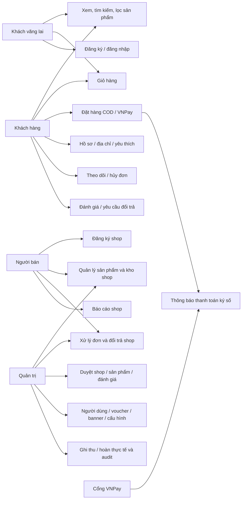
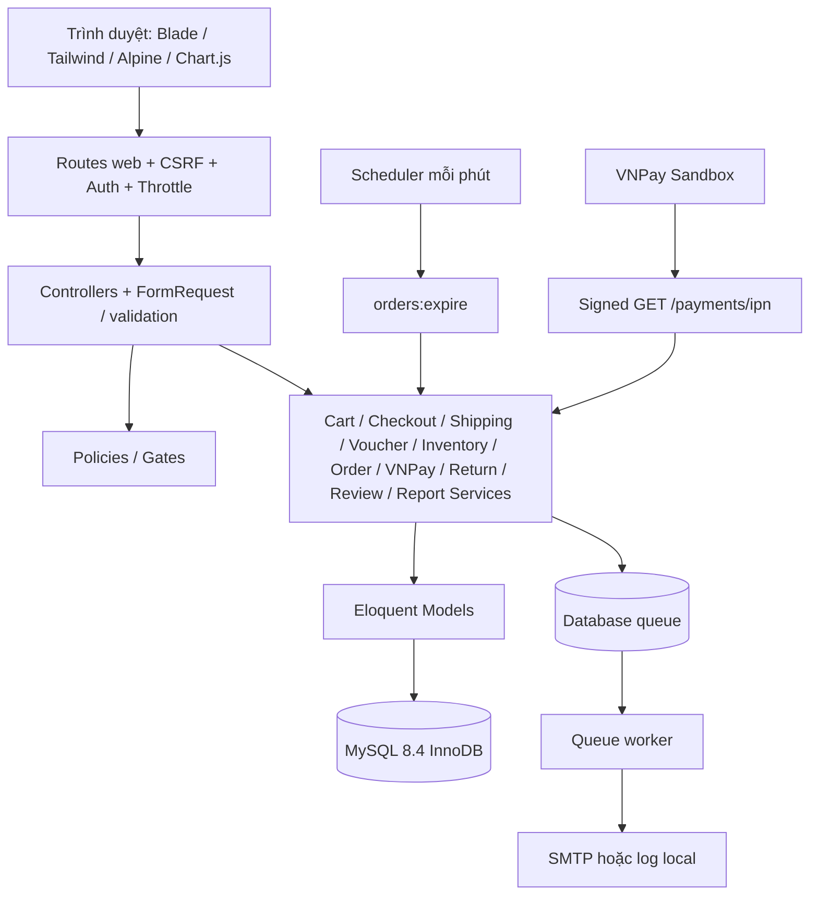
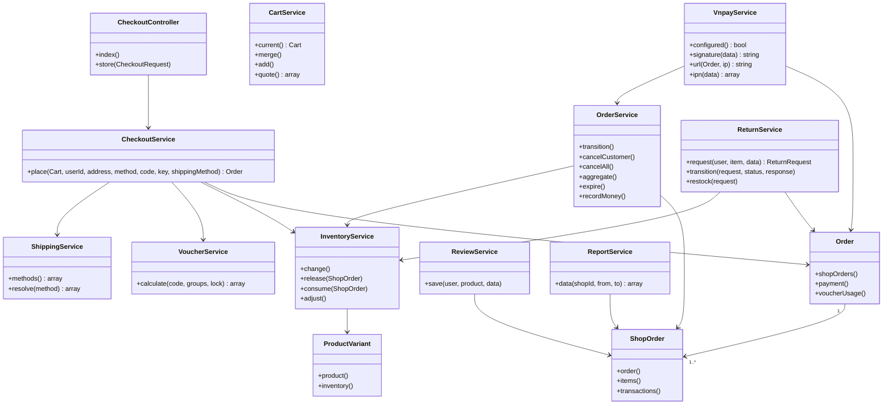
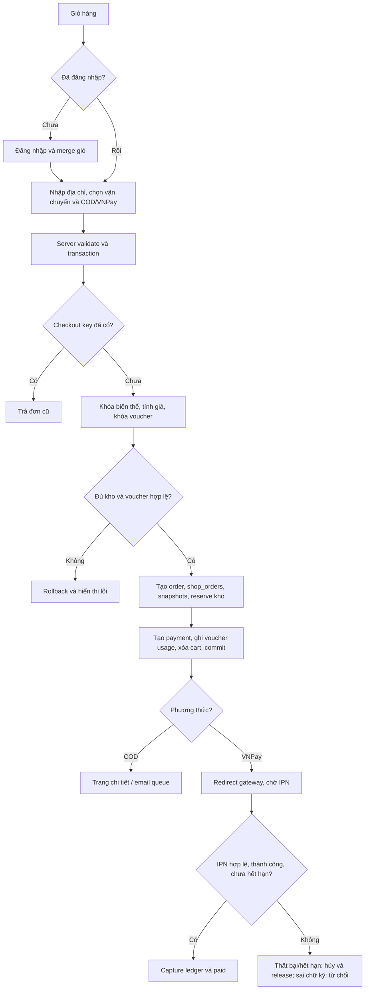
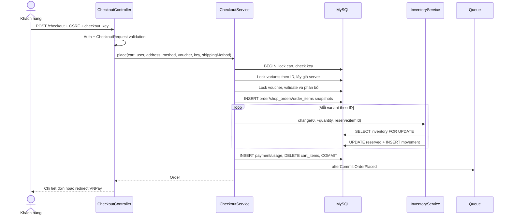
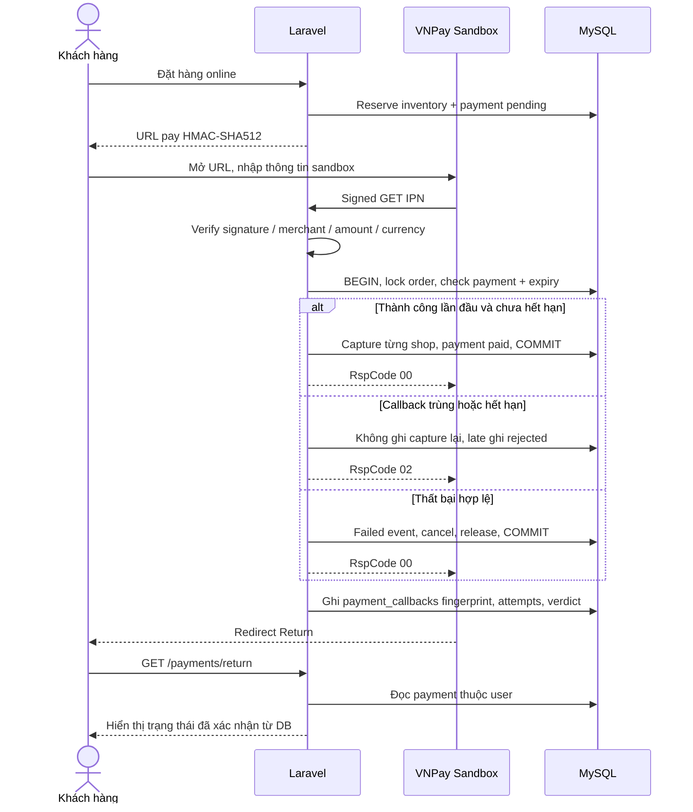
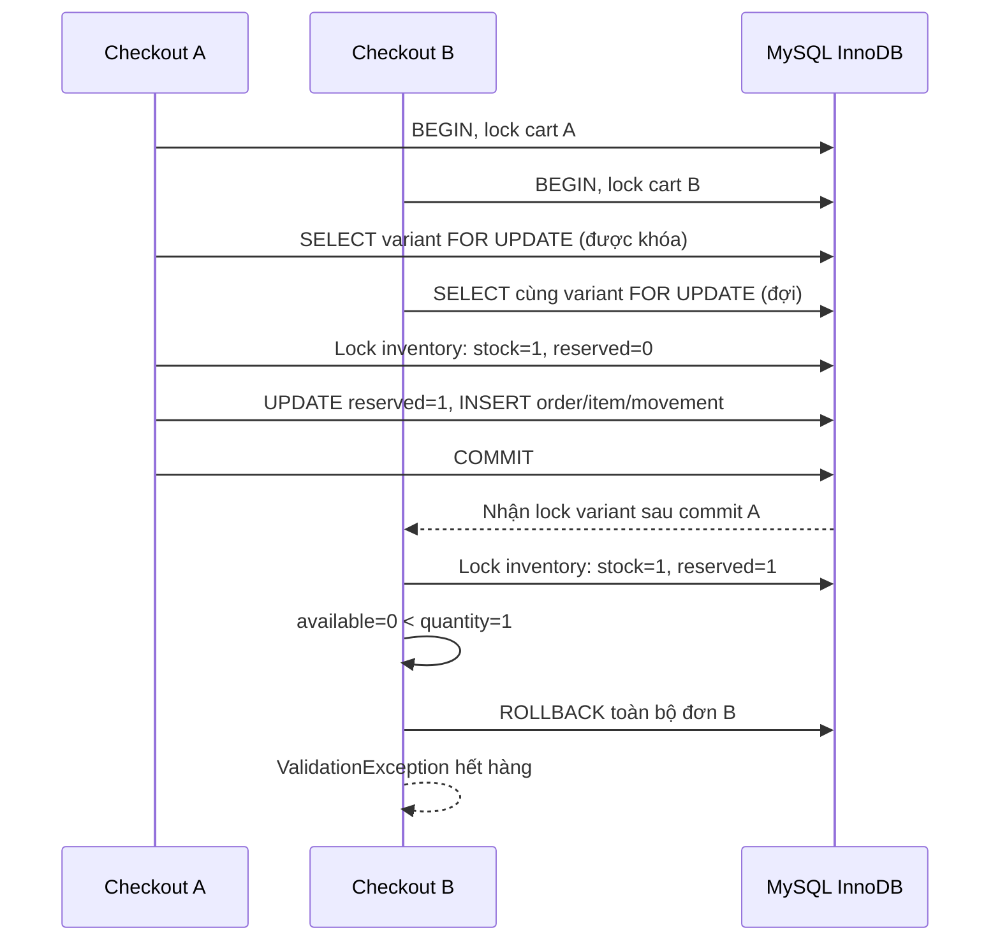
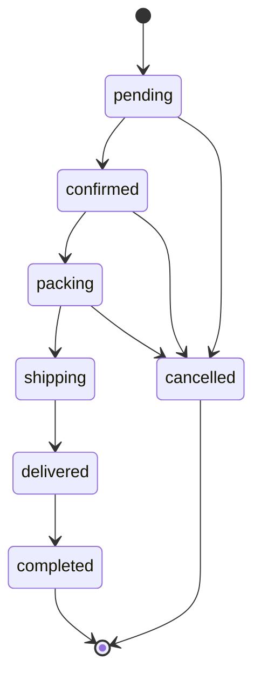
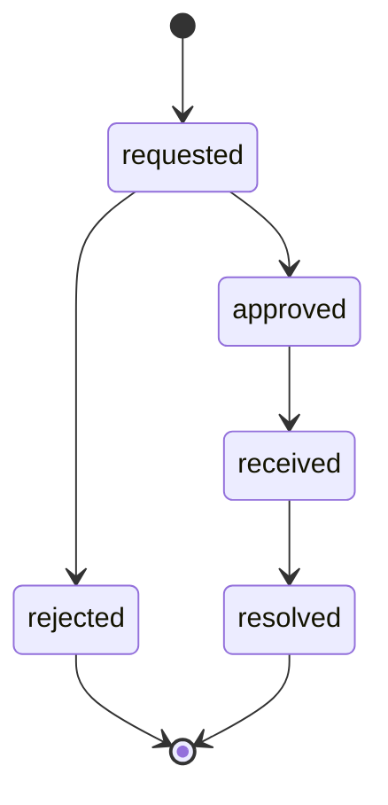

# Sơ đồ hệ thống

ERD đầy đủ: [erd.mmd](erd.mmd), sinh từ schema MySQL đang chạy. Từ điển PK/FK/unique/index: [schema-dictionary.md](schema-dictionary.md). Quan hệ FK trong ERD biểu thị parent → children; quan hệ one-to-one được ràng buộc thêm bằng UNIQUE trong từ điển (inventories.variant, payment.order, shops.owner).

## Use Case Diagram (Mermaid flowchart)

## Kiến trúc

## Class Diagram (các lớp nghiệp vụ chính)

## Activity Diagram — checkout

## Sequence — đặt hàng

## Sequence — VNPay

## Sequence — hai khách tranh hàng cuối

## State machine — đơn con

Đổi/trả có state riêng và giao dịch refund riêng; không làm đơn con nhảy ngược từ delivered. Parent có pending/processing/delivered/completed/cancelled do OrderService.aggregate tính.

## State machine — yêu cầu đổi/trả

Nhập lại kho là hành động idempotent riêng khi received/resolved; không đồng nghĩa đã hoàn tiền. /manage/returns gọi ReturnService, còn ghi hoàn thực tế gọi OrderService.recordMoney.
